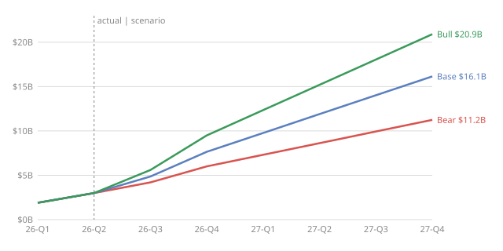

# Nebius Scenario Model: Output

*Generated by `models/nebius_scenarios.py` from `data/nebius_kpis.csv`. Do not edit by hand; change the assumptions in the script and re-run.*

> Not investment advice. This is a mechanical scenario model: every output follows from the assumptions table, not from a forecast of what Nebius will report.

## Assumptions

| | Bear | Base | Bull |
|---|---|---|---|
| Connected GW, end of 2026 | 0.8 | 0.9 | 1.0 |
| Connected GW, end of 2027 | 1.5 | 1.9 | 2.2 |
| Year-end ARR per connected MW ($M) | 7.5 | 8.5 | 9.5 |
| AI cloud adj. EBITDA margin by Q4 2027 | 45% | 52% | 57% |
| 2027 capex per MW added ($M) | 32 | 30 | 28 |
| Share of capex funded by prepayments | 35% | 50% | 55% |

Shared assumptions: 2026 capex at the guidance midpoint ($22.50B); 40% of the H2 2026 ARR increase lands by September; Avride and TripleTen held at Q2 2026 run-rates. Quarterly revenue = average of opening and closing ARR / 4, scaled by the Q2 2026 ratio of AI revenue to ARR.

**Funding gap** = capex − customer prepayments − adjusted EBITDA. It is a rough measure of outside capital needed: it ignores interest, taxes and working capital (which make it larger) and existing cash (which covers part of it). 2026 figures include H1 actuals.

## Results

| | Bear | Base | Bull |
|---|---|---|---|
| **2026** group revenue | $3.04B | $3.39B | $3.78B |
| 2026 year-end ARR | $6.00B | $7.65B | $9.50B |
| 2026 group adj. EBITDA (margin) | $1.26B (41%) | $1.47B (43%) | $1.70B (45%) |
| 2026 capex | $22.50B | $22.50B | $22.50B |
| 2026 funding gap (capex − prepayments − EBITDA) | $11.82B | $9.45B | $8.50B |
| **2027** group revenue | $8.13B | $11.20B | $14.30B |
| 2027 year-end ARR | $11.25B | $16.15B | $20.90B |
| 2027 group adj. EBITDA (margin) | $3.53B (43%) | $5.56B (50%) | $7.71B (54%) |
| 2027 capex | $22.40B | $30.00B | $33.60B |
| 2027 prepayments | $7.84B | $15.00B | $18.48B |
| 2027 funding gap | $11.03B | $9.44B | $7.41B |

### 2026 guidance check

| | Bear | Base | Bull | Guidance |
|---|---|---|---|---|
| Revenue | $3.04B | $3.39B | $3.78B | $3.00B–$3.40B |
| Year-end ARR | $6.00B | $7.65B | $9.50B | $7–9B |
| Adj. EBITDA margin | 41% | 43% | 45% | ~40% |

### What the 2027 funding gap means in shares

New shares needed to fund the 2027 gap entirely with equity (in millions), at different share prices. For scale: 271.9M shares were outstanding on June 30, 2026, plus 21.1M NVIDIA pre-funded warrants. In practice part of the gap is funded with debt and convertibles, and the ~$9.1B of cash and restricted cash on hand (June 30, 2026) absorbs some of it first.

| Share price | Bear | Base | Bull |
|---|---|---|---|
| $150 | 74M | 63M | 49M |
| $225 | 49M | 42M | 33M |
| $300 | 37M | 31M | 25M |

## ARR paths

## Quarterly detail ($M unless noted)

**Bear**

| Quarter | ARR end ($B) | Group revenue | AI margin | Group adj. EBITDA | Capex | Prepayments | Funding gap |
|---|---|---|---|---|---|---|---|
| 2026-Q3 | 4.20 | 852 | 49% | 364 | 7,185 | 2,515 | 4,306 |
| 2026-Q4 | 6.00 | 1,204 | 48% | 526 | 7,185 | 2,515 | 4,144 |
| 2027-Q1 | 7.31 | 1,569 | 47% | 690 | 5,600 | 1,960 | 2,950 |
| 2027-Q2 | 8.62 | 1,877 | 47% | 821 | 5,600 | 1,960 | 2,819 |
| 2027-Q3 | 9.94 | 2,185 | 46% | 948 | 5,600 | 1,960 | 2,692 |
| 2027-Q4 | 11.25 | 2,493 | 45% | 1,069 | 5,600 | 1,960 | 2,571 |

**Base**

| Quarter | ARR end ($B) | Group revenue | AI margin | Group adj. EBITDA | Capex | Prepayments | Funding gap |
|---|---|---|---|---|---|---|---|
| 2026-Q3 | 4.86 | 930 | 50% | 412 | 7,185 | 3,592 | 3,180 |
| 2026-Q4 | 7.65 | 1,475 | 50% | 691 | 7,185 | 3,592 | 2,901 |
| 2027-Q1 | 9.78 | 2,052 | 51% | 990 | 7,500 | 3,750 | 2,760 |
| 2027-Q2 | 11.90 | 2,550 | 51% | 1,253 | 7,500 | 3,750 | 2,497 |
| 2027-Q3 | 14.02 | 3,049 | 52% | 1,520 | 7,500 | 3,750 | 2,230 |
| 2027-Q4 | 16.15 | 3,548 | 52% | 1,791 | 7,500 | 3,750 | 1,959 |

**Bull**

| Quarter | ARR end ($B) | Group revenue | AI margin | Group adj. EBITDA | Capex | Prepayments | Funding gap |
|---|---|---|---|---|---|---|---|
| 2026-Q3 | 5.60 | 1,016 | 51% | 464 | 7,185 | 3,952 | 2,769 |
| 2026-Q4 | 9.50 | 1,779 | 52% | 874 | 7,185 | 3,952 | 2,359 |
| 2027-Q1 | 12.35 | 2,571 | 53% | 1,318 | 8,400 | 4,620 | 2,462 |
| 2027-Q2 | 15.20 | 3,240 | 55% | 1,714 | 8,400 | 4,620 | 2,066 |
| 2027-Q3 | 18.05 | 3,909 | 56% | 2,127 | 8,400 | 4,620 | 1,653 |
| 2027-Q4 | 20.90 | 4,577 | 57% | 2,555 | 8,400 | 4,620 | 1,225 |
